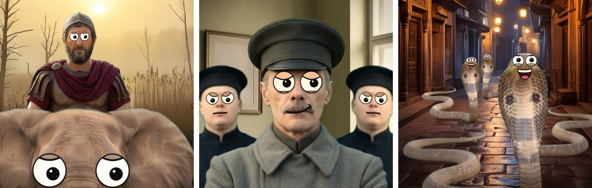
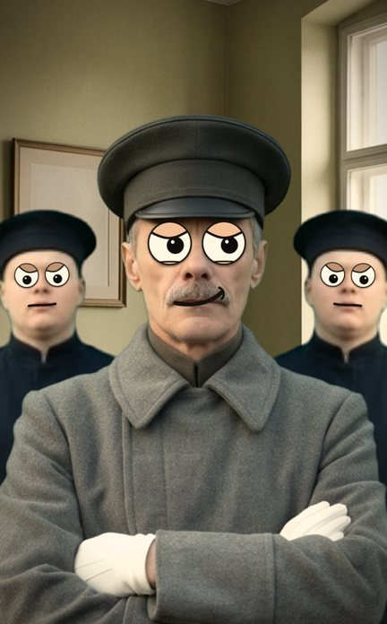
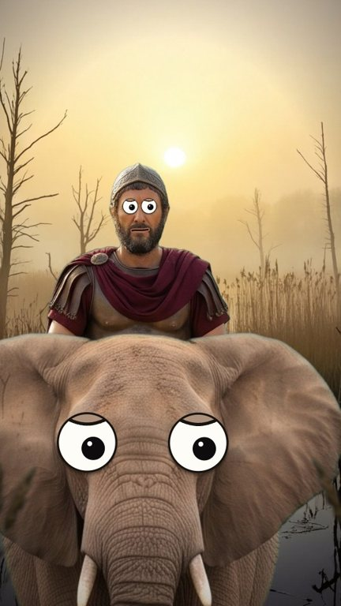
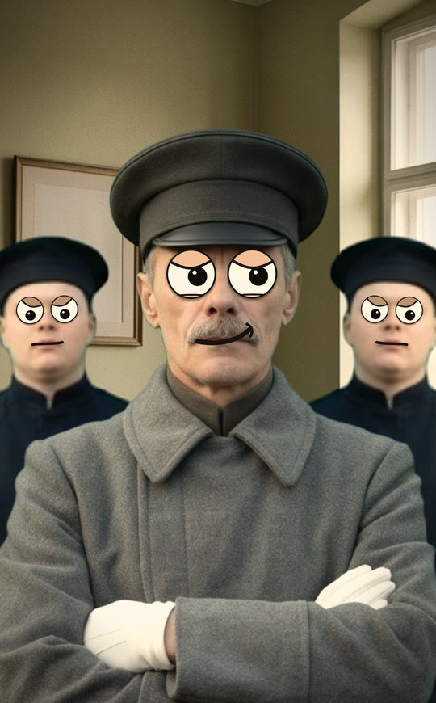
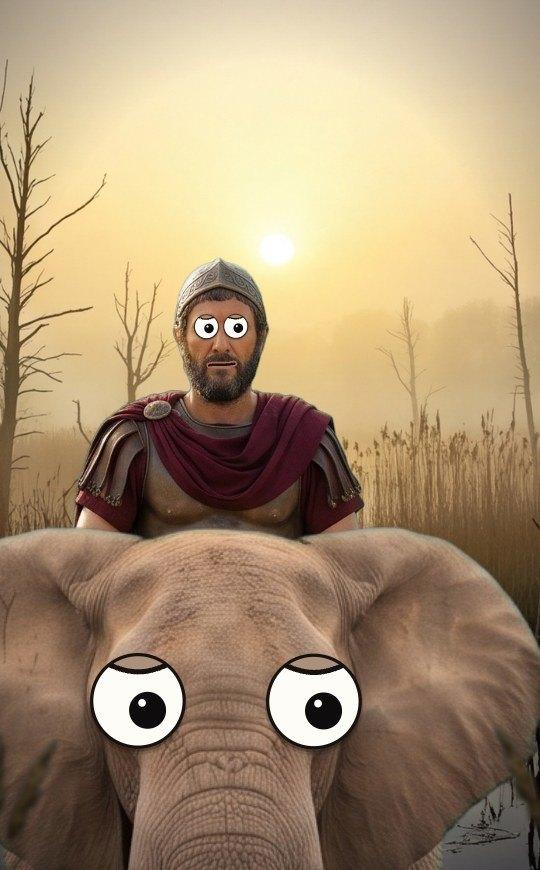
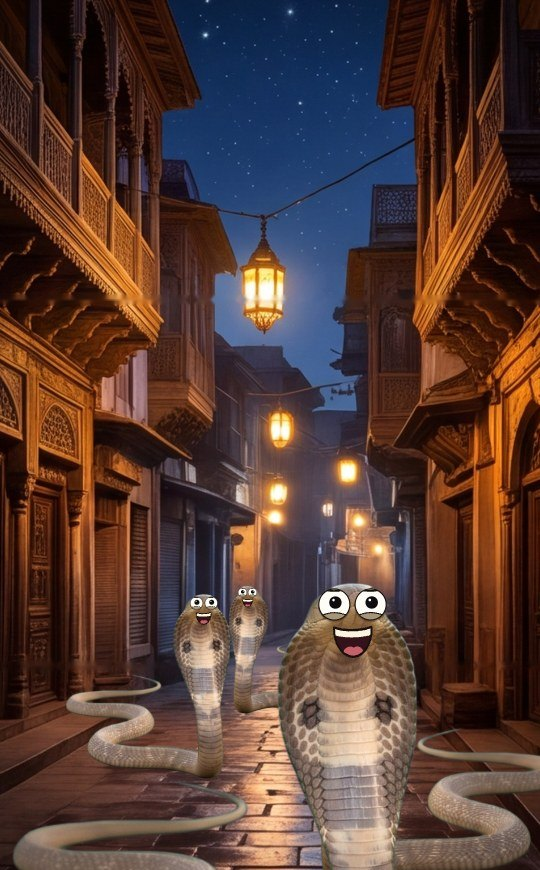

<p align="center">
  
</p>

# Video skills

**Skills that teach Claude to make one kind of video well.**

A prompt gives you a video that looks like everybody else's. A skill is the whole method: how to
pick the story, check it really happened, write the words, plan every shot and every face, and
check the film before anybody sees it. Claude follows it and stops for your yes along the way.

Free and open. Star it so you can find it again, or press Watch to hear when a new skill lands.

## The skills

| | Skill | What it does |
|---|---|---|
|  | **[Drawn eyes](skills/drawn-eyes)** | A true story as a vertical Short. Real-looking people, drawn eyes that do the acting, one spoken word on screen at a time. |
|  | **[Create a skill](skills/create-a-skill)** | Give Claude videos you made, or have the right to study: one to start, more of the same kind if you have them. It works out how that kind of video is made and writes it down as a skill of your own. |

## Start in one paste

Open Claude Code (the desktop app or the terminal) and paste:

```
Download github.com/AskEditor/video-skills and read skills/drawn-eyes.
Then make me a drawn-eyes Short. Find me three true stories to choose from.
```

Claude shows you three stories. You choose one. It writes the words with two sources beside every
line and lists every shot. You bring the pictures and the voice, from any tools you have, and it
draws the film on your own computer.

**The faster way:** connect [AskEditor](https://askeditor.com/claude) first. It makes the pictures and the
voice, shows you the price before it draws anything, and every shot lands on a timeline you can open.

### Or install them for good

On a Mac or Linux:

```
git clone https://github.com/AskEditor/video-skills
mkdir -p ~/.claude/skills
cp -r video-skills/skills/* ~/.claude/skills/
```

Then start a new chat.

## On your own, or with AskEditor

The skill is free either way. This is what each route gives you.

| | The skill on its own | With [AskEditor](https://askeditor.com) |
|---|---|---|
| The story, checked | Yes | Yes |
| The script, with sources | Yes | Yes |
| The shot list, the picture briefs | Yes | Yes |
| The voice | Yours, or your own voice tool | Built in |
| People and rooms | Your own picture tool | Built in |
| Eyes and mouths that act | Drawn by a script on your computer | Ready, as a kit |
| Maps, walking, things that fall, sound effects | No | Yes |
| Changing one shot | Ask Claude, and draw the film again | Leave a note on that shot |
| The edit | A finished video file | One timeline, every part open |
| What you need | Python, ffmpeg and about 800 MB of free tools | An AskEditor account, connected to Claude |
| What it costs | Nothing to us. Your own tools may charge you | Credits: 370 for the 52 second one below |

## Made in this style

| The shoemaker | Hannibal | The cobra effect |
|:---:|:---:|:---:|
|  |  |  |
| A shoemaker puts on a uniform and arrests the mayor | Thirty-seven elephants over the Alps, for a promise made at nine | British India paid for dead snakes. What the records really say |
| 52 s · 32 shots · 370 credits | 93 s · 54 shots · 874 credits | 84 s · 54 shots · 469 credits |

All three were voiced, built and exported in AskEditor. Some of their pictures were cleaned up outside it.

## What they refuse to do

- **Both:** use another creator's words, pictures, frames or voice.
- **Drawn eyes:** make a living person's face or voice, pass off a story with one source as a fact, or remake a whole film to fix one shot.
- **Create a skill:** fetch a video for you, or work from one you have no right to.

## Licence

The skills and the script are MIT: use them, change them, sell what you make. The pictures in this repository are
AskEditor's, show the result, and are not part of the licence (see [NOTICE.md](NOTICE.md)).

Made by [AskEditor](https://askeditor.com). Want the editing skills too? See
[ai-video-editing-skills](https://github.com/AskEditor/ai-video-editing-skills).
