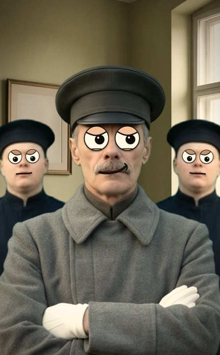

# Drawn eyes

A true story as a vertical Short. The people look real. The eyes and mouths are drawn, and they do all the acting. The narrator never
jokes. The face does.

**You give it** one true story, or ask it for three.

**It stops for your yes** at the story, the words, the list of shots, and the stills. With AskEditor it also shows the price, and lets you pick the voice.

**You get** the finished film, about fifty seconds. On your own computer you bring the pictures and the voice. In
[AskEditor](https://askeditor.com) they are made for you, and every shot stays open to change.

 

| File | What it holds |
|---|---|
| `SKILL.md` | The order of work. This is what Claude reads first |
| `story.md` | The story test, and how to tell if it has been done |
| `words.md` | How the words are written |
| `shots.md` | The shot list and how to brief the pictures |
| `faces.md` | The eyes and the mouth |
| `make.md` | Making the film on your own computer |
| `make/` | The script that draws it, with the face finder and the font it uses |
| `checks.md` | What a second reader looks for |
| `examples/the-shoemaker.md` | One film's story, with its sources |
